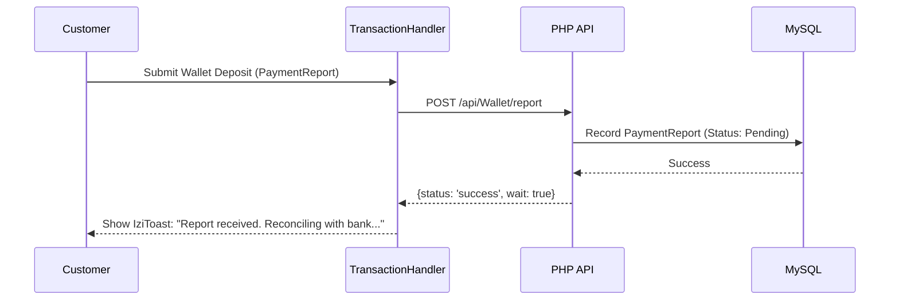

# Frontend Technical Specification - AreaBazaar (Phase 1)

This document provides the detailed frontend mapping for the AreaBazaar platform, acting as the Senior Frontend Architect's blueprint for implementation.

## 1. View Map (Interface Hierarchy)

### A. Customer Views (Mobile-First)
- **Home/Landing**: Swiper carousels for "Active Auctions" and "Coming Soon". 
- **Product Detail (Quick View)**: Izimodal popup with variant selection and price-wave countdown.
- **Cart/Checkout**: Summary view with wallet balance check.
- **Wallet Sidebar**: Quick view of balance, surveillance status, and recent transactions.
- **Deposit Flow (Entry)**: Form to generate `PaymentRequest`.
- **Order History**: List of orders with current logistics status (In Warehouse, Dispatched, Ready for Pickup).
- **Delivery ACK**: Entry for `DeliveryPassCode` and quality verification check-list.

### B. Staff & Admin Views (Dashboard)
- **Admin Hub**: Summary of system health, suspicious wallet flags, and commission totals.
- **Inventory Manager**: Interface for `ProductInventoryService` approvals.
- **Auction Setup**: Form for configuring "Price Waves" for `show_products`.

### C. Partner Contexts (FRM, SBA, ZBDp)
- **FRM Portal**: Associated customer list, commission ledger, and "Package Received" scanner.
- **SBA/ZBDp/WHM Side-Panels (Appscript)**:
    - **SBA Supply Panel**: Data entry for bulk products. Supports bulk selection logic.
    - **ZBDp Logistics Panel**: Transport bill generation and delivery tracking.
    - **WHM Side-Panel**: Quality check results and split-product calculations.

---

## 2. Interactivity Layer (JS Modules)

### Class: `UIController`
Handles the initialization and state of jQuery plugins.
- `initModals()`: Wraps Izimodal for generic alerts and custom forms.
- `notify(msg, type)`: Wraps IziToast for `success`, `error`, `info`.
- `initCarousels()`: Configures Swiper with lazy-loading and touch interactions.

### Class: `FormValidator`
- `validate(formId)`: Checks for required fields, phone number formats (Nigerian standard), and Ref-code validity.
- `setLoading(btnId, state)`: Manages button disabled states/spinners during submission.

---

## 3. Application State & Propagation

### Storage Schemas
| Storage Key | Target | Data Schema (JSON) |
| :--- | :--- | :--- |
| `ab_cart` | `localStorage` | `[{variant_id: int, qty: int, price_at_add: float}]` |
| `ab_user_meta` | `sessionStorage`| `{name: str, role: str, wallet_bal: float, is_flagged: bool}` |
| `ab_active_session`| `sessionStorage`| `{auction_id: int, end_time: timestamp, wave_step: int}` |

---

## 4. Transaction Handling

### Class: `TransactionHandler`
The core engine for communication with the PHP `api/` layer.
```javascript
class TransactionHandler {
  static async request(endpoint, method = 'POST', data = {}) {
    UIController.setLoading(data.submitBtn, true);
    try {
      const response = await fetch(`/api/${endpoint}`, {
        method,
        headers: { 'Content-Type': 'application/json' },
        body: JSON.stringify(data)
      });
      const result = await response.json();
      if (result.status === 'success') {
        UIController.notify(result.message, 'success');
        return result.data;
      } else {
        UIController.notify(result.error, 'error');
        return null;
      }
    } catch (e) {
      UIController.notify("Transaction Failed. Check Connection.", 'critical');
    } finally {
      UIController.setLoading(data.submitBtn, false);
    }
  }
}
```

---

## 5. HCI & Resource Optimization
- **High-Contrast Design**: Buttons and status badges use high-contrast HSL colors for outdoor readability (common for agents/delivery).
- **Lazy Loading**: Swiper carousels only load the first 3 images; subsequent images load on-scroll/on-slide.
- **Micro-Animations**: Subtle transitions on price wave changes to draw attention without being intrusive.

---

## 6. Logic Flow (Mermaid)


